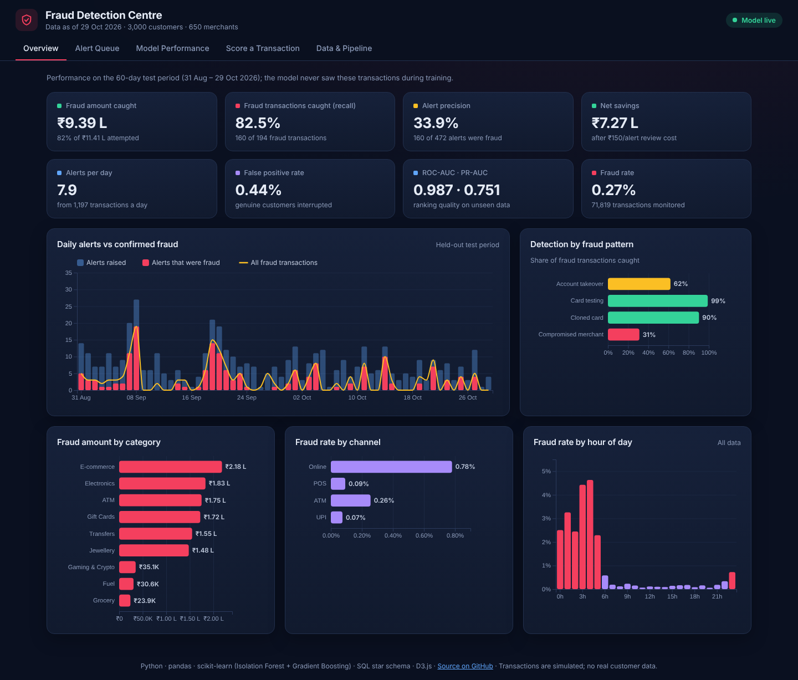
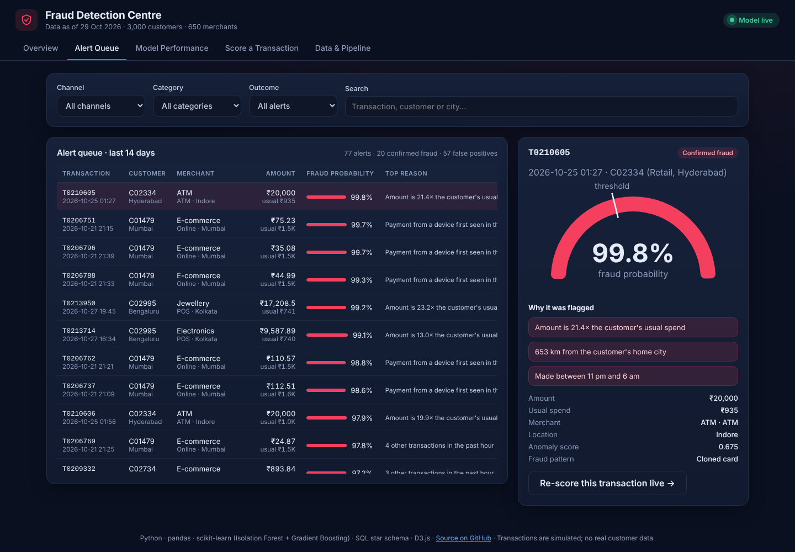
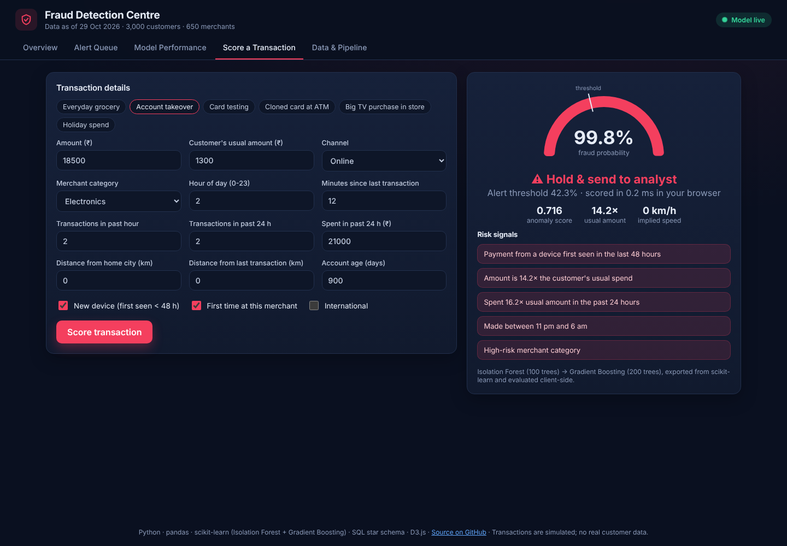
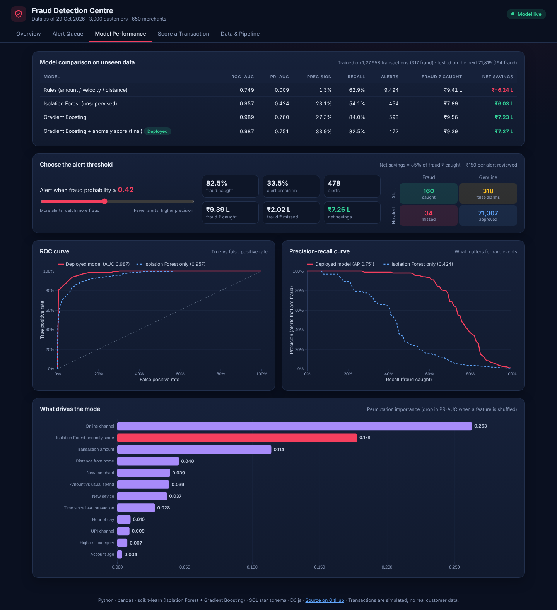
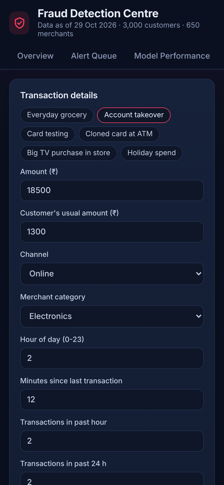

# Banking Fraud Detection System

A machine-learning fraud detection system for card, UPI, ATM and online payments. It combines an
**Isolation Forest anomaly detector** with a **Gradient Boosting classifier**, chooses the alert threshold by
**business cost**, explains every alert with **reason codes**, and serves everything through a live
**fraud-operations dashboard** that can **score transactions in real time in the browser**.

**Live demo:** https://banking-fraud-detection-w3e7.onrender.com



## Results on unseen data

Time-based split: trained on ~4 months, tested on the **next 60 days** (71,819 transactions, 194 fraud, 0.27% fraud rate).

| Model | ROC-AUC | PR-AUC | Precision | Recall | Net savings* |
|---|---|---|---|---|---|
| Rules (amount / velocity / distance) | 0.749 | 0.009 | 1.3% | 62.9% | −₹6.24 L |
| Isolation Forest (unsupervised) | 0.957 | 0.424 | 23.1% | 54.1% | ₹6.03 L |
| Gradient Boosting | 0.989 | 0.760 | 27.3% | 84.0% | ₹7.23 L |
| **Gradient Boosting + anomaly score (deployed)** | **0.987** | **0.751** | **33.9%** | **82.5%** | **₹7.27 L** |

\*Net savings = 85% of fraud amount caught − ₹150 analyst cost per alert. The deployed model catches **82% of fraud
value** while interrupting only **0.44%** of genuine transactions (~8 alerts/day). Exact numbers vary slightly with each
data refresh.

The Isolation Forest alone, trained **without any labels**, already beats hand-written rules by a wide margin, and its
anomaly score is the **second most important feature** of the final model. That makes the system more resilient to new
fraud patterns that haven't been labelled yet.

## Features

- **Realistic simulation** of 216K transactions for 3,000 customers and 650 merchants across Indian cities, including four
  fraud patterns (account takeover, card testing, cloned card, compromised merchant) *and* genuine behaviour that looks
  suspicious (travel, new phones, big purchases, bursts of small UPI payments)
- **Leakage-free feature engineering** (19 features): amount vs the customer's own history, 1 h / 24 h velocity, time
  since last transaction, distance from home and implied travel speed, new device / merchant, channel, time of day
- **Two-stage model**: Isolation Forest → Gradient Boosting, with class weighting for 0.27% imbalance
- **Proper evaluation**: time-based split, ROC/PR curves, permutation importance, recall per fraud pattern, comparison
  against rules and single models
- **Cost-based threshold** that maximises money saved rather than accuracy, with an interactive threshold slider
- **Explainable alerts**: reason codes such as *"Amount is 21× the customer's usual spend"* or *"Implied travel speed
  of 4,600 km/h"*
- **Real-time scoring in the browser**: both scikit-learn models are exported to JSON and re-implemented in JavaScript;
  a test verifies the browser predictions match scikit-learn to within 1e-9
- **SQL star schema** (SQLite + SQL Server with monthly partitions and a clustered columnstore index) and
  **Power BI** assets with DAX measures and **incremental refresh**

## Dashboard

| Alert queue with reason codes | Live transaction scoring |
|---|---|
|  |  |

| Model performance and threshold tuning | Mobile |
|---|---|
|  |  |

## How it works

```
transactions ─▶ clean ─▶ features (history, velocity, geo, device) ─▶ Isolation Forest ─▶ anomaly score ─┐
                                                                                                       ▼
                                  confirmed fraud labels ─────────────────────────────▶ Gradient Boosting ─▶ probability
                                                                                                       │
                     cost-based threshold ◀───────────────────────────────────────────────────────────┘
                              │
          ┌───────────────────┼──────────────────────────┬─────────────────────────────┐
          ▼                   ▼                          ▼                             ▼
   alert + reason codes   SQL star schema          model.json → browser scorer    Power BI (DAX, incremental refresh)
```

## Tech stack

| Area | Tools |
|---|---|
| Data & features | Python, pandas, NumPy |
| Machine learning | scikit-learn: IsolationForest, GradientBoostingClassifier, permutation importance |
| Data model | SQL star schema (SQLite; SQL Server DDL with partitioning + columnstore), window-function queries |
| BI | Power BI: DAX measures, Power Query (M), incremental refresh |
| Dashboard | HTML/CSS/JavaScript, D3.js, client-side model inference |
| DevOps | GitHub Actions CI (train + tests + JS/Python parity), Render |

## Run locally

```bash
git clone https://github.com/shivesh122/banking-fraud-detection.git
cd banking-fraud-detection
pip install -r requirements.txt

python build.py --refresh          # simulate data → features → train → evaluate → SQL → dashboard (~2 min)
python -m http.server 8000 --directory site
# open http://localhost:8000
```

```bash
python -m unittest discover -s tests -t .   # unit tests + browser-scorer parity (needs Node.js)
python score.py --top 10                     # score transactions from the CLI with reason codes
```

The SQLite warehouse is at `data/warehouse/fraud.db`; example queries are in [`sql/analysis_queries.sql`](sql/analysis_queries.sql).

## Project structure

```
├── scripts/generate_data.py   # transaction + fraud simulation
├── fraud/
│   ├── features.py            # leakage-free feature engineering
│   ├── model.py               # Isolation Forest + Gradient Boosting, evaluation, JSON export
│   ├── reasons.py             # alert reason codes
│   └── warehouse.py           # star schema load, data-quality checks, Power BI exports
├── build.py                   # end-to-end pipeline
├── score.py                   # command-line scoring
├── site/                      # dashboard + scorer.js (in-browser inference) + model/model.json
├── sql/                       # SQLite + SQL Server schemas, analysis queries
├── powerbi/                   # DAX, Power Query (incremental refresh), report guide
├── exports/                   # star schema CSVs for Power BI
└── tests/                     # unit tests and JS/Python parity test
```

## Notes

- Data is **simulated**; no real customer information is used. The same pipeline runs on real transaction exports
  with the same columns.
- Fraud labels in banking arrive late (chargebacks take weeks), which is why an unsupervised anomaly score matters:
  it can flag new patterns before labels exist.

## License

MIT © Shivesh Tiwari
